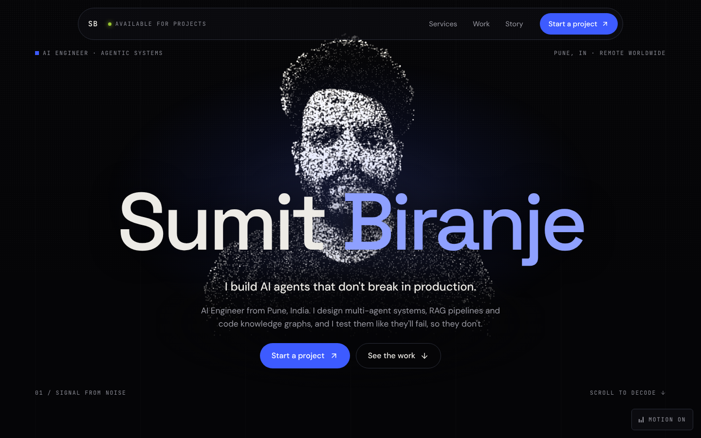

# Sumit Biranje: portfolio



Next.js 16 (App Router, Turbopack) · SCSS modules · GSAP (ScrollTrigger, SplitText, ScrambleText) · Lenis · Three.js with custom GLSL.

Design and content docs live in `docs/`: `01-profile.md`, `02-positioning.md`, `03-theme.md`, `04-master-prompt.md`.

## Run

```bash
npm install
npm run dev          # http://localhost:3000
npm run build && npm start
```

## Where things live

| What | File |
|---|---|
| All copy and facts | `src/content/site.ts` |
| Colours, fonts, global styles | `src/styles/globals.scss`, `src/styles/_tokens.scss` |
| Hero: "signal from noise" WebGL | `src/components/sections/Hero.tsx`, `src/components/three/*` |
| Scroll reveals (data attributes) | `src/components/RevealRoot.tsx` |
| Case studies | `src/app/work/[slug]/page.tsx` (data in `projects`) |
| AI / SEO | `src/app/llms.txt/route.ts`, `robots.ts`, `sitemap.ts`, `opengraph-image.tsx`, JSON-LD in `layout.tsx` |

## Add your portrait (hero particles)

1. Remove the background from a well-lit photo (face and shoulders, about 1000px tall) and export a transparent **WebP/PNG**.
2. Save it as `public/photos/portrait-cutout.webp`.
3. In `src/content/site.ts` set `portrait: "/photos/portrait-cutout.webp"`.

The particles then sample your face (bright pixels become dots) and morph into the knowledge graph on scroll. Without a photo, the scene falls back to a procedural cloud.

## Contact form

There's no backend yet: the form opens the visitor's email app with the fields filled in. To capture leads, swap `onSubmit` in `src/components/sections/Contact.tsx` for a Server Action, or use a form service such as Formspree or Resend.

## Deploy (Vercel)

This repo is linked to a Vercel project. Every push to `main` deploys to production, and every other branch gets a preview URL.
Set the env var `NEXT_PUBLIC_SITE_URL` to the final URL (used for canonical links, the sitemap and Open Graph).

## Lighthouse (local production build)

| | Performance | Accessibility | Best Practices | SEO |
|---|---|---|---|---|
| Desktop | 98 | 100 | 100 | 100 |
| Mobile | 88 | 100 | 100 | 100 |

Both rows are from the latest run (with photos and the new fonts).

Performance choices: WebGL loads after `load` and idle (on phones, after the first interaction or 4s), DPR is capped at 1.75 and rendering pauses off-screen; no loader on phones; the display font uses `optional` so the hero name never re-paints; there's a MOTION ON/OFF toggle and `prefers-reduced-motion` support.
